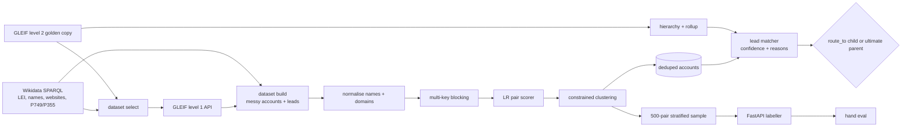

# lead2account

Lead-to-account matching and account dedupe (the job LeanData does inside Salesforce),
built and measured on **51,581 messy CRM-style records derived from real companies**:
GLEIF LEI records (level 1 entities + level 2 "who owns whom") joined with Wikidata.

> **Results below use automatic labels** (two records match iff they come from the same
> GLEIF LEI). **Hand-labelled evaluation: pending (0/500 labelled).** The labelling tool
> and the 500 sampled pairs are in this repo; see [SETUP.md](SETUP.md).

## Results (TEST split, automatic LEI ground truth)

Every number is copied from [`results/metrics.json`](results/metrics.json) /
[`results/report.md`](results/report.md), produced by `make experiment report`.
Brackets are 95% bootstrap CIs. Models and thresholds were fitted on DEV only; TEST was
run once.

| Account dedupe (pairwise) | Precision | Recall | F1 |
|---|---|---|---|
| Baseline: exact normalised name OR same website site | 0.723 [0.673, 0.769] | 0.672 [0.662, 0.683] | 0.697 [0.673, 0.718] |
| **l2a**: fuzzy features + LR + constrained clustering | **0.794** [0.776, 0.812] | **0.749** [0.739, 0.758] | **0.771** [0.760, 0.782] |
| l2a + registry-id cannot-link (ERP records carry an LEI) | 0.867 [0.834, 0.893] | 0.778 [0.769, 0.787] | 0.820 [0.801, 0.834] |

| Duplicates (TEST, 19,330 account records, 8,090 entities) | Before | After l2a | After baseline |
|---|---|---|---|
| Account records per true entity | 2.389 | **1.281** | 1.382 |
| Duplicate rate | 58.1% | **21.9%** | 27.6% |
| Over-merged clusters (>1 legal entity) | 0 | 7.43% | 5.33% |

| Lead-to-account (6,504 TEST leads) | Precision | Recall |
|---|---|---|
| All leads | 0.905 [0.897, 0.913] | 0.877 [0.869, 0.886] |
| Free-mail leads (gmail, yahoo, ...) | 0.891 [0.874, 0.907] | 0.858 [0.840, 0.877] |
| Lead typed an alias / former name | 0.928 [0.916, 0.940] | 0.870 [0.855, 0.884] |
| Subsidiary lead using the parent's domain | 0.815 [0.785, 0.841] | 0.806 [0.777, 0.833] |
| Parent rollup routing (route to top account) | 0.841 [0.814, 0.867] | 0.811 [0.783, 0.836] |

Leads whose company has no CRM account were correctly left unmatched 91.8% of the time.
Blocking keeps 79.5% of true pairs on TEST while discarding 99.96% of all pairs; that
pair completeness is the ceiling on dedupe recall and the main thing to improve next.
Throughput on a 2-vCPU container, one process: ~10,400 records/s dedupe, ~6,000 leads/s.

## Problem

Inbound leads arrive as `(company typed by a human, email, website, country)`. Routing
them needs the right **account**, but the CRM's accounts are themselves duplicated
(ERP import + enrichment vendor + reps' manual entries + list uploads) and organised in
parent/child hierarchies. The hard cases are the ones that cost money:

* free-mail addresses (no domain signal),
* subsidiaries sharing the parent's domain or a country path (`bp.com`, `microsoft.com/en-ca`),
* acquisitions / rebrands and former names (Wikidata aliases, P1366 "replaced by"),
* the same name in different countries (one group, many legal entities),
* legal forms and scripts across countries (`株式会社`, `ООО`, `Tbk`, `Pvt Ltd`, `S.A.B. de C.V.`).

## Data (real, public, CC0)

| Source | What | Count |
|---|---|---|
| Wikidata (query.wikidata.org) | items with an LEI (P1278): label, aliases, official names (P1448), native-script labels, websites (P856), P749/P355 parents/subsidiaries, P1366 replaced-by | 53,279 items |
| GLEIF level 1 (api.gleif.org) | legal name, other / transliterated names, legal + HQ country | 16,075 entities |
| GLEIF level 2 golden copy | ACTIVE direct / ultimate accounting-consolidation links | 261,415 links (70,114 touching our pool) |

`make select build` picks 11,000 Wikidata companies with an LEI and website, adds their
GLEIF parents and up to two GLEIF subsidiaries each, and 1,912 companies that get leads
but no account. Account records use the **real name forms and websites from the sources**;
on top of that we inject documented synthetic CRM noise (one-character typos in 20% of
"list upload" records, case changes, dropped legal suffixes, `www`/`https` variants,
missing countries/websites, reps typing the parent's website for 40% of GLEIF-only
subsidiaries). Lead e-mail local parts are **role-based (`sales@`, `procurement@`) or random
tokens; no real personal data is used anywhere**. See
[`data/processed/dataset_stats.json`](data/processed/dataset_stats.json).

Ground truth: shared LEI. Splits are by corporate group (connected component of the
hierarchy) so a parent and its subsidiaries never straddle dev and test
([ADR 0003](docs/adr/0003-splits.md)).

## What's built (`src/l2a`)

| Module | Purpose |
|---|---|
| `normalize.py` | unicode folding (unidecode), legal forms for ~150 suffix/prefix variants across countries (Inc, Ltd, GmbH, Pvt Ltd, SA de CV, PLC, KK/株式会社, OOO/ООО, PT…Tbk, Oyj, AB publ…), core + key tokens |
| `domains.py` | eTLD+1 from the vendored Public Suffix List, site keys for country paths / subdomains, free-mail detection |
| `blocking.py` | 8 blocking keys, block-size cap, pair completeness / reduction ratio |
| `features.py`, `model.py` | 19 pairwise features, logistic regression stored as JSON, F1-tuned threshold |
| `cluster.py` | union-find over edges by score with cannot-link rules (country-without-domain, negative edges, optional registry id) |
| `hierarchy.py` | parent/child graph from GLEIF level 2 + Wikidata, ultimate-parent rollup, cycle-safe |
| `pipeline.py` | `dedupe()` and `LeadMatcher.match()` returning account, confidence, reason codes, routed account (`route="child"` or `"ultimate_parent"`) |
| `experiment.py`, `metrics.py` | dev-train / dev-tune / test protocol, pairwise P/R/F1 with component bootstrap, duplicate rates, per-hard-case lead metrics, throughput |
| `sampling.py`, `labeller/` | stratified 500-pair sample + FastAPI single-page labeller with keyboard shortcuts and CSV export |
| `hand_eval.py`, `report.py` | hand-label P/R/F1 + automatic-vs-hand agreement; Markdown + HTML report |

Example reason codes: `DOMAIN_EXACT`, `DOMAIN_SAME_REGISTRABLE_DIFFERENT_SITE`,
`NAME_EXACT_NORMALISED`, `NAME_ACRONYM`, `NAME_FUZZY_0.91`, `COUNTRY_CONFLICT`,
`FREEMAIL_DOMAIN_IGNORED`, `PARENT_ROLLUP`, `BELOW_THRESHOLD`.

## Architecture



## How to run

```bash
python3.11 -m venv .venv && . .venv/bin/activate
pip install -e '.[dev]'
make check                 # ruff + mypy --strict + pytest (offline)
make experiment report     # reproduce results/ from the committed data (~1 min)
make label                 # hand-label the 500 pairs at http://127.0.0.1:8765
make hand-eval report      # fold hand labels into the report
# optional, needs network (Wikidata may rate-limit to 1 query/minute):
make fetch select gleif build
```

```python
from pathlib import Path
from l2a.cluster import CannotLink
from l2a.model import PairModel
from l2a.pipeline import LeadMatcher, account_records, dedupe, read_csv_gz
from l2a.records import Idf, make_record

rows = read_csv_gz(Path("data/processed/accounts.csv.gz"))
accs = account_records(rows)
acc_model = PairModel.from_json(Path("models/account_pair_model.json"))
dd = dedupe(accs, acc_model, CannotLink(False, True, 0.2))
matcher = LeadMatcher(accs, dd.labels, PairModel.from_json(Path("models/lead_pair_model.json")), Idf(accs))
m = matcher.match(make_record("L1", "Siemens", website="https://www.siemens.com/fr/", email="achats@siemens.com", country="FR"))
print(m.account, round(m.confidence, 3), m.reasons)
# 12673 0.999 ['DOMAIN_EXACT', 'NAME_EXACT_NORMALISED', 'DOMAIN_LABEL_EQUALS_NAME', 'COUNTRY_MATCH']
# -> cluster of record A012673 "SIEMENS SAS" (FR), not Siemens AG: the /fr site key decides
```

## Hand-labelled evaluation: pending (0/500)

`labels/pairs_to_label.csv` holds 500 TEST pairs stratified over borderline scores,
parent/child pairs, same-name-different-country, shared-domain-different-site, free-mail,
parent-domain and alias leads. The UI hides model scores and automatic labels.
`make hand-eval` will report model P/R/F1 on the human labels and how often the automatic
LEI label agrees with a human (a direct measure of ground-truth noise).

## Limitations (honest list)

* **Automatic labels are LEI-strict.** "BP p.l.c." and "BP Exploration Operating Company
  Limited" are different entities to GLEIF; a sales team may disagree. Hand labels include a
  `parent_child` class to quantify this.
* Synthetic noise is layered on real name forms; real CRMs have other noise (merged
  fields, stale records). Rates are documented in `dataset.py`.
* Blocking recall (79.5%) caps dedupe recall: names that share no token, domain or
  acronym (native-script names whose transliteration differs from the English label,
  brand vs. legal name) are never compared. Next step: transliteration-aware keys
  (e.g. pykakasi for Japanese) and embedding-based ANN blocking.
* The chosen dedupe threshold (0.15) sits at the edge of the dev grid; the negative-edge
  cannot-link rule does most of the precision work. Correlation clustering would be the
  principled upgrade.
* Over-merging (7.4% of clusters) is concentrated in groups whose subsidiaries all list the
  parent's website (real Wikidata behaviour, e.g. wind-farm SPVs, BP subsidiaries).
* Wikidata's query service was rate-limiting (1 request/min) during collection; fetches
  are cached per query so reruns resume.

## Compliance

Only public CC0 company data. No person-level data: lead e-mails use role-based or random
local parts. No outreach is performed, so CAN-SPAM / GDPR / DPDP obligations do not arise
in this repo; if the matcher is wired to a live CRM, run it under the CRM's existing
lawful basis and suppression lists.

## Licence

MIT (code). Public Suffix List: MPL-2.0. GLEIF and Wikidata data: CC0.
